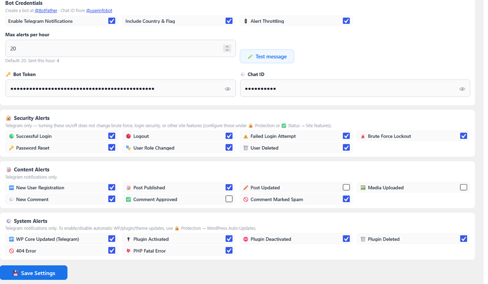
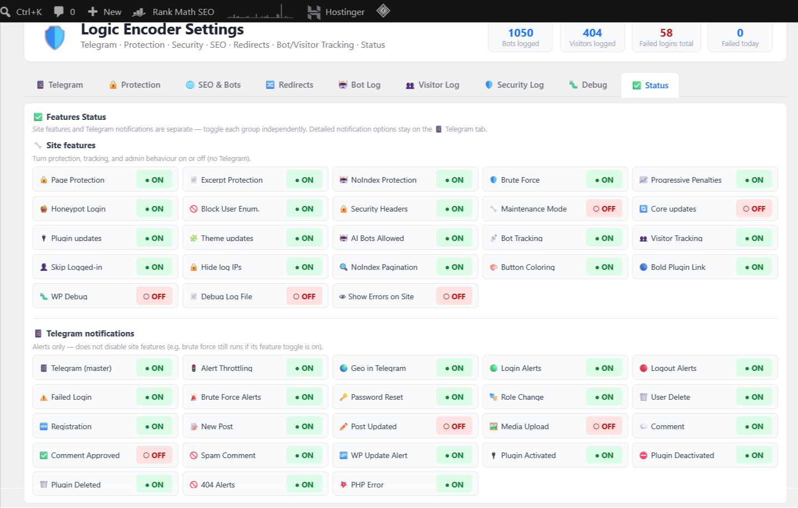
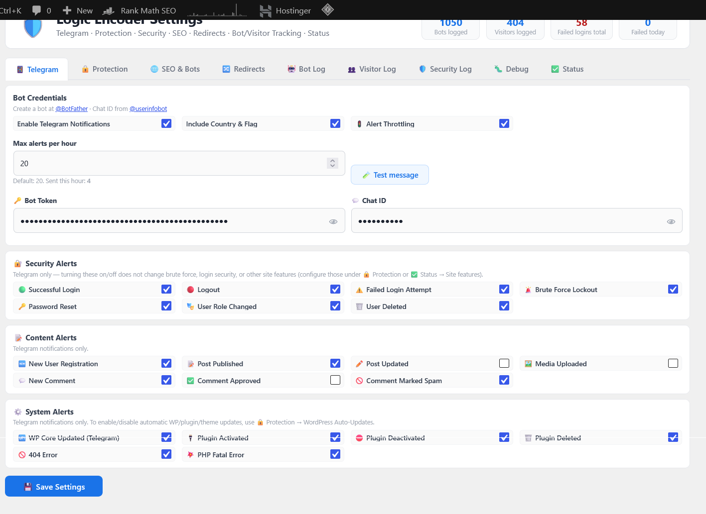
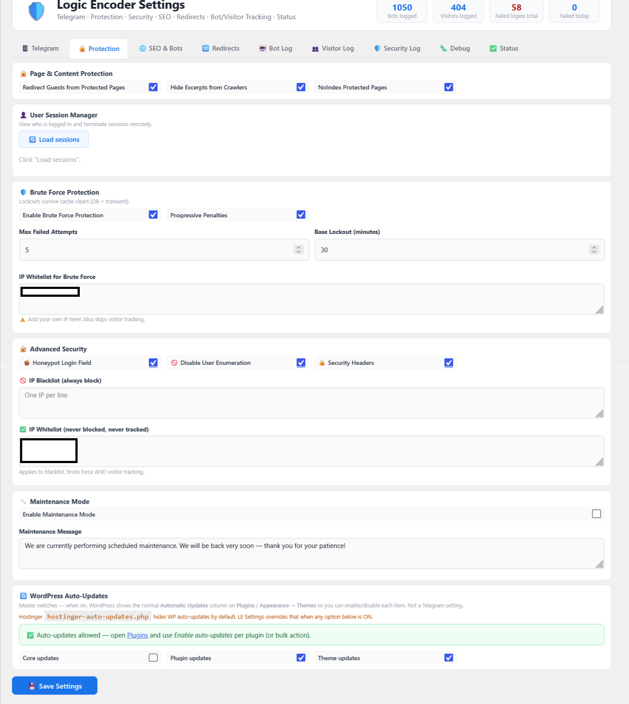
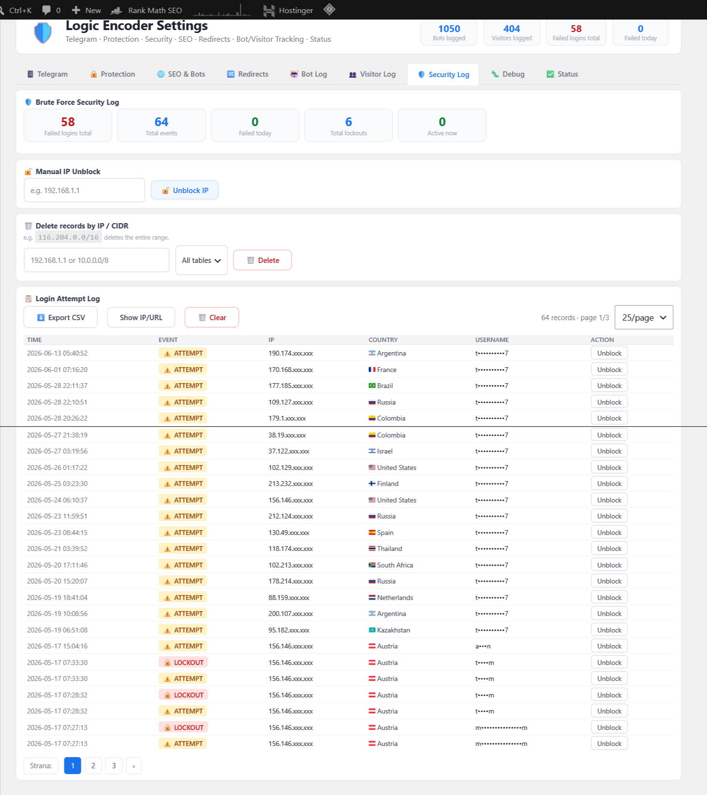
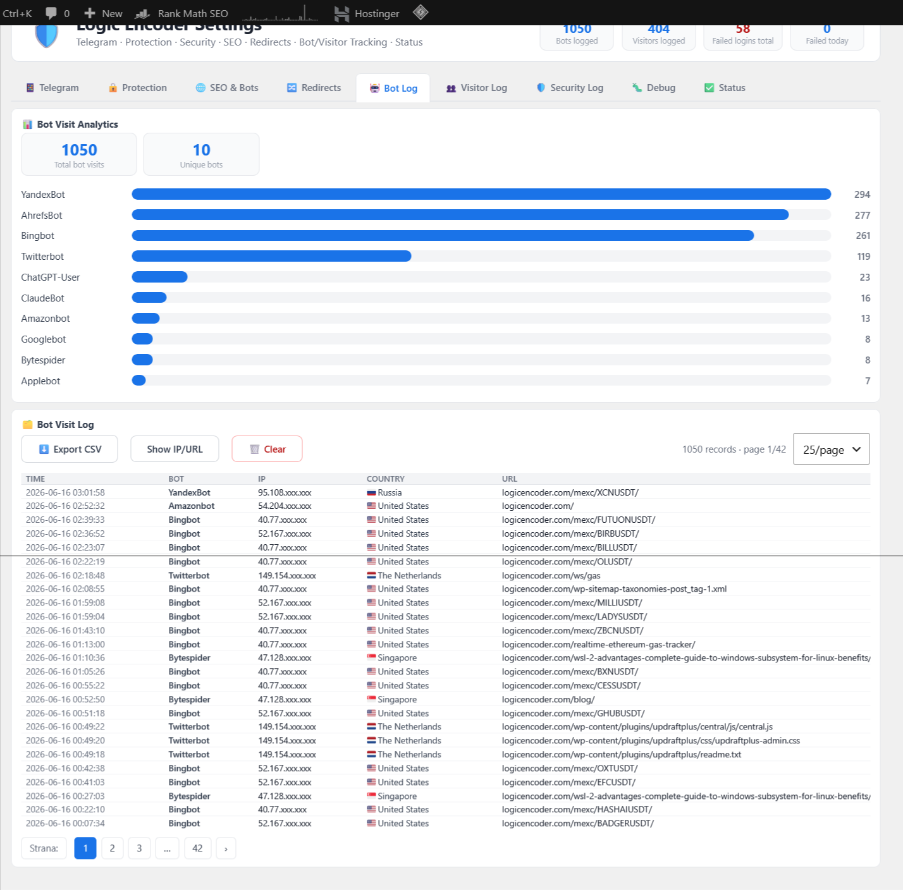
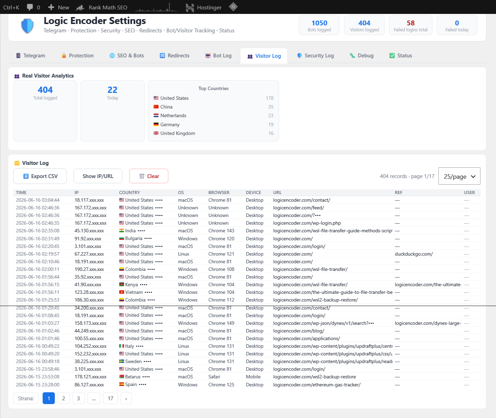
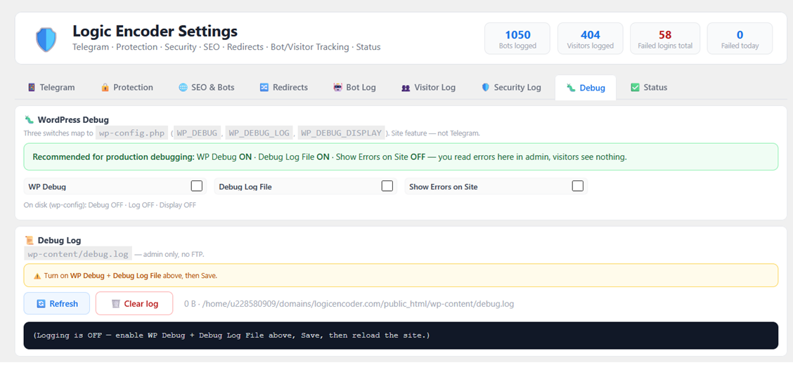

# LE Settings

Site operations often become a collection of unrelated settings pages, alerts and logs. LE Settings brings the site's supported operational controls into one WordPress console, helping the owner review protection, notifications and publishing-related preferences with less switching.

## Tech stack

| Layer | Technologies |
|---|---|
| Application | PHP, WordPress |
| Supporting technologies | HTML, CSS, JavaScript; Telegram |

## See the current site setup

The status area organises enabled features and notification choices into a readable overview. It helps an operator check the site's intended behaviour before investigating a particular issue. Related controls remain close to the information they affect.

The status view provides a shared starting point for recurring site checks. Review the intended feature state before following a more specific event into its associated log or setting.

## Keep important events visible

Telegram notifications provide a way to receive selected site events away from the administration screen. Notification choices let the owner decide which events deserve attention. Logs provide a place to review the corresponding activity when more detail is needed.

Choose notifications around the events that matter to the site owner. The corresponding administration views remain available when an alert needs a more detailed explanation.

## Maintain protection and access preferences

Protection and login-related controls cover supported hardening choices. Security logs and IP-management tools assist with investigation and routine maintenance. The shared view helps the owner keep protection choices and recent events connected.

Recent events make access and protection preferences easier to review in context. Inspect the relevant information before deciding whether an IP or login-related choice should change.

Security logs connect the site's protection preferences with observed events. Review the relevant record before deciding whether a setting or access choice needs attention.

## Manage publishing and traffic context

SEO preferences, crawler-related choices and redirects support keeping the site's public behaviour organised. Bot and visitor views help inspect traffic context. These tools bring related operational decisions together without making the console a substitute for the site's content editor.

Publishing behaviour and traffic observations often belong to the same investigation. The console keeps those related controls nearby while the site's content remains managed in its normal editorial tools.

Visitor information adds another perspective when reviewing the site's traffic. Keep it distinct from crawler activity so different kinds of requests can be investigated appropriately.

## Investigate and adapt

Debug information, site details and log filtering help narrow an issue when the summary is insufficient. The shared console makes recurring checks easier to find. It complements the site's shop and member plugins while retaining its own operational role.

The debug area supports the cases that the status summary cannot explain. It gives recurring maintenance a recognisable place without merging the responsibilities of the shop or member plugins.

---

Private code: [le-settings-plugin](https://github.com/logicencoder/le-settings-plugin)

See [REPOS.md](REPOS.md) for related repositories.

**[Logic Encoder](https://logicencoder.com)** · [GitHub](https://github.com/logicencoder) · [Contact](https://logicencoder.com/contact/)
